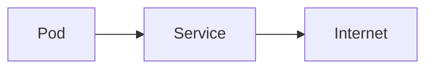

# Сетевая модель подов

## Тезисы

- У каждого пода свой IP в CNI-сети
- Наружу — через Service, kube-proxy балансирует
- DNS внутри кластера резолвит сервисы

## Как я это понял

- Под — как мини-ВМ со своим адресом, сервис — розетка в стене

## Схема

