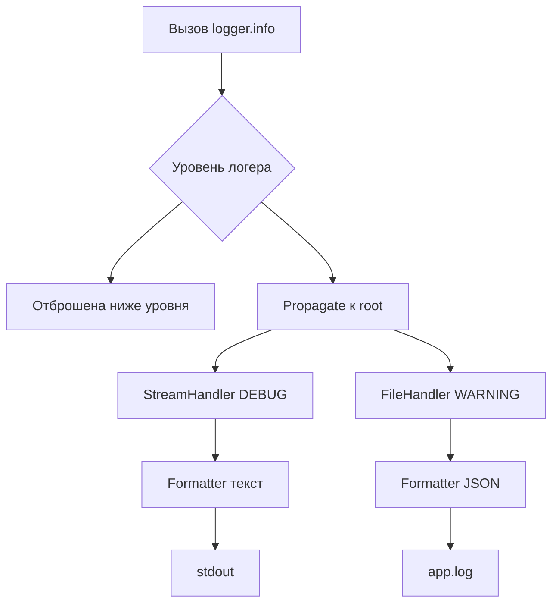

# Python logging: Logger, Handler, двухступенчатые уровни и JSON-логи

> Архитектура logging из четырёх сущностей (Logger/Handler/Formatter/Filter), ловушка молчащих логов без хендлеров и lastResort, двухступенчатые уровни, ленивое форматирование и продакшн-паттерн: JSON в stdout, сбор инфраструктурой (VictoriaLogs).

## Ключевые понятия

- **Logger** — Объект, в который пишет бизнес-код (info/debug/error). Уровень логера отсеивает сообщения ниже него; именованные логеры образуют иерархию (app.utils → app → root), записи всплывают наверх при propagate=True.
- **Handler** — Обработчик, выводящий запись в место назначения: StreamHandler (stderr по умолчанию), FileHandler, свои классы. У логера их 0..∞. Без хендлеров выводить некому — частая причина «молчащих» логов.
- **lastResort** — Запасной хендлер библиотеки на уровне WARNING+. Именно поэтому logger.warning(...) виден даже без настройки, а logger.info(...) — нет. Мнимая «магия уровня» — на деле работа аварийного хендлера.
- **Formatter** — По одному на хендлер; превращает LogRecord в строку. Свой класс (например JSONFormatter) даёт структурированные логи: поля time, level, logger, message плюс кастомные.
- **Filter** — Вешается на логер/хендлер; может отбрасывать записи, но чаще обогащает их контекстом (user_id, request_id), копируя LogRecord.
- **Двухступенчатые уровни** — Логер решает, что пропускать, а у каждого хендлера свой уровень. Поэтому легко получить «в stdout всё DEBUG, в файл только INFO+ JSON».
- **Ленивое форматирование** — logger.debug("order for %s", user_id): подстановка происходит только если сообщение реально выводится. F-строка вычисляется всегда, даже при выключенном уровне. T-строки (3.14) — допустимый компромисс.
- **extra** — Способ передать доп. поля в LogRecord (например user_id) для отдельного JSON-поля. Нельзя использовать имена, занятые в LogRecord; у Formatter задают defaults, чтобы отсутствие поля не роняло логирование.
- **contextvars + middleware** — Надёжный способ проставить request_id в async-приложении (FastAPI): переменная контекста ставится в мидлваре, фильтр добавляет её в каждую запись — записи разных запросов не путаются.
- **dictConfig** — Декларативная настройка всего логирования словарём: version: 1, disable_existing_loggers: false, секции filters/formatters/handlers/loggers/root. Вызывается один раз наверху приложения.
- **QueueHandler / QueueListener** — Вывод логов в отдельном потоке через очередь: блокирующая работа с сетью/диском не тормозит основной поток. Нюансы: respect_handler_level=True, GIL, слушателя надо stop().
- **basicConfig** — Минимальная настройка точки входа: вешает StreamHandler на root-логер. Лечение «молчащего» логера — добавить хендлер, а не менять уровень.

## Тезисы

- Архитектура logging — четыре сущности: Logger принимает сообщения, Handler выводит (stdout/файл/почта), Formatter превращает LogRecord в строку/JSON, Filter отбирает и обогащает записи.
- Молчание логов лечится добавлением хендлера (например logging.basicConfig), а не сменой уровня: logger.setLevel(INFO) + logger.info без хендлеров ничего не выведет.
- WARNING и выше видны «из коробки» только благодаря аварийному lastResort-хендлеру библиотеки — это не свойство уровня.
- Уровни двухступенчатые: логер решает, что пропускать, хендлер — что выводить; так одновременно получается DEBUG в stdout и WARNING+ в файл.
- Использовать ленивое форматирование logger.debug("x %s", val) вместо f-строк: f-строка вычисляется всегда, даже когда уровень выключен (в видео — 3-секундный repr впустую).
- Продакшн-паттерн: в модулях logger = logging.getLogger(__name__), вся настройка один раз наверху через dictConfig; JSON-логи в stdout собирает инфраструктура (VictoriaLogs через Docker).
- Анти-паттерны: print вместо логов, многострочные сообщения, логеры на каждый запрос (утечка памяти), ПДн в логах (имя/телефон — нельзя, внутренний id — можно).

## Как я это понял

- «Гипотеза при «молчащем» логере: «нужно добавить просто другой уровень логера, то есть на warning перевести»»

## Схема

## Дозакрепить

> [!WARNING]
> Различать роль уровня логера и наличие хендлеров: правило «молчит — ищи хендлеры, а не уровень»; повторить механику lastResort
> [!WARNING]
> Маршрутизация записей по хендлерам с разными уровнями (вопрос 2 блиц-опроса: debug/info/warning при логере INFO, StreamHandler DEBUG и FileHandler WARNING — остался без ответа)

## Вопросы на потом

- Подробнее разобрать иерархию логеров и propagate
- Собрать мини-лабу FastAPI + JSON-логи + VictoriaLogs на homelab (LXC + docker-compose, порт 9428, /insert/jsonline)
- Аудит существующих сервисов: где f-строки внутри logger.debug при выключенном DEBUG и сколько лишней работы они делают
- Изучить stacklevel=2 в лог-хелперах и поле event (payment.failed) для алертов

## Источники

- src_a6e138ad (`src_a6e138ad#1`)