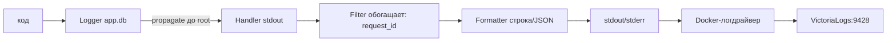

# Python logging: конвейер, request_id через ContextVar, JSON-логи и VictoriaLogs

> Конспект видео о stdlib logging: конвейер Logger-Handler-Formatter-Filter, propagate до root, ленивое форматирование, request_id через ContextVar для FastAPI, JSON-логи в stdout и их сбор Docker-логдрайвером в VictoriaLogs.

## Ключевые понятия

- **propagate** — Дочерний логер передаёт записи родителям до root; уровень предка при пробросе не проверяется — проверяются уровни его хендлеров
- **ContextVar + фильтр-обогатитель** — ContextVar хранит request_id в async: middleware выставляет, фильтр дописывает в копию LogRecord
- **JSON-логи** — Свой Formatter с format() выдаёт JSON; вывод в stdout/stderr для парсинга коллекторами
- **VictoriaLogs** — Централизованное хранилище (порт 9428), Docker-логдрайвер везёт туда stdout/stderr контейнеров
- **extra + defaults** — extra={...} добавляет поля в LogRecord; defaults задают значения по умолчанию централизованно
- **Logger** — Точка входа для кода; иерархия по имени (app.db), наверху root
- **Handler** — Доставка: stdout/stderr, файл, почта, Telegram; свой уровень при доставке
- **Formatter** — LogRecord → строка или JSON; цветная консоль — это просто Formatter с ANSI
- **Filter** — Не только отсекает, но и обогащает record контекстом
- **Ленивое форматирование** — logger.debug("юзер %s", user) — строка собирается только если запись пройдёт уровни

## Тезисы

- Конвейер из 4 сущностей: Logger → Handler → Formatter → Filter; Filter не только фильтрует, но и обогащает записи контекстом
- propagate передаёт записи до root; уровень предка не проверяется — проверяются уровни его хендлеров
- Ленивое форматирование: logger.debug("юзер %s", user) вместо f-строк — f-строки вычисляются всегда
- request_id через ContextVar в middleware FastAPI: логи одного HTTP-запроса связываются автоматически
- JSON-логи в stdout/stderr → Docker-логдрайвер → VictoriaLogs (порт 9428): поиск по полям без парсинга
- Никаких паролей/токенов/PII в логах — кейс British Airways (CVV в логах, штраф)
- stdlib вместо loguru: вся экосистема Python логируется через stdlib; демо-образ python:3.14-slim + uv

## Как я это понял

- «Иерархия логеров = дерево ресурсов Proxmox (CT → пул → нода): сообщение всплывает наверх, на каждом уровне решают хендлеры-потребители»
- «ContextVars = trace-ID в CI-пайплайне: проставил один раз в middleware, виден на всех стадиях без ручной передачи»

## Схема

## Вопросы на потом

- Почему logger.info у root без хендлеров не выводится, а WARNING — да? (механизм logging.lastResort)
- t-строки Python 3.14: когда форматоры начнут поддерживать их из коробки?

## Источники

- Логирование в Python — всё, что надо знать и использовать (`src_a6e138ad#1`)