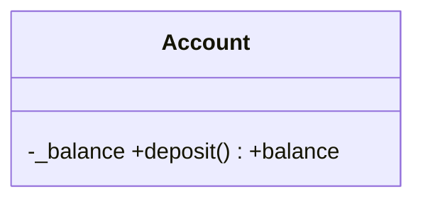

# 03 — Модель данных

## Идентификаторы

- Внутри БД — `INTEGER PRIMARY KEY`.
- Сущности, на которые ссылаются из MD-файлов или URL, имеют строковый `uid` с префиксом: `src_` (источник), `act_` (активность), `cnv_` (разговор), `ses_` (сессия), `blk_` (блок), `crs_` (курс). Формат: префикс + 8 hex (`new_uid` в `util.py` уже есть — расширить до 8 символов для новых записей, старые не трогать).
- В MD-файлах ссылки только по `uid`, никогда по int id.

## Схема SQLite v2

Ниже — логическая схема. В коде таблицы объявляются через SQLAlchemy Core в `modules/<m>/infra/tables.py` того модуля, которому принадлежат; FTS5-таблицы создаются в миграции сырым SQL.

| Модуль | Таблицы |
|---|---|
| library | `sources`, `chapters`, `jobs` |
| knowledge | `categories`, `blocks`, `block_tags`, `block_sources`, `block_links`, `block_versions` |
| learning | `activities`, `sessions` |
| chat | `conversations`, `messages` |
| courses | `courses`, `course_items` |
| profile | `settings` |
| search | `blocks_fts`, `chapters_fts` |
| agent (сквозной) | `agent_runs` |

Внешние ключи между таблицами разных модулей допустимы на уровне БД, но в коде модуль читает чужие данные только через публичный сервис владельца.

```sql
CREATE TABLE sources (
  id INTEGER PRIMARY KEY AUTOINCREMENT,
  uid TEXT NOT NULL UNIQUE,
  kind TEXT NOT NULL,                 -- book | video | web
  title TEXT NOT NULL,
  author TEXT,
  url TEXT,
  local_path TEXT,
  status TEXT NOT NULL DEFAULT 'chosen', -- found|chosen|processing|processed|failed
  summary TEXT,                        -- обзор источника (LLM), 5–10 предложений
  meta_json TEXT NOT NULL DEFAULT '{}',-- pages, duration, lang, video_id, cover_color …
  created_at TEXT NOT NULL,
  updated_at TEXT NOT NULL
);

CREATE TABLE chapters (
  id INTEGER PRIMARY KEY AUTOINCREMENT,
  source_id INTEGER NOT NULL REFERENCES sources(id),
  idx INTEGER NOT NULL,
  title TEXT NOT NULL,
  path TEXT NOT NULL,
  tokens_est INTEGER,
  summary TEXT,                        -- 3–5 предложений
  key_points_json TEXT NOT NULL DEFAULT '[]', -- 3–7 пунктов
  has_exercises INTEGER NOT NULL DEFAULT 0,   -- LLM отметил упражнения/практику в главе
  UNIQUE(source_id, idx)
);

CREATE TABLE categories (               -- индекс kb/categories.yaml
  path TEXT PRIMARY KEY,               -- programming/python/oop
  title TEXT NOT NULL,                 -- «ООП»
  parent_path TEXT,                    -- programming/python (NULL для корня)
  color TEXT,                          -- имя цвета палитры: sky|violet|emerald|amber|rose|zinc …
  icon TEXT,                           -- имя иконки lucide: code, chef-hat, server …
  sort INTEGER NOT NULL DEFAULT 0
);

CREATE TABLE activities (
  id INTEGER PRIMARY KEY AUTOINCREMENT,
  uid TEXT NOT NULL UNIQUE,
  source_id INTEGER NOT NULL REFERENCES sources(id),
  course_id INTEGER REFERENCES courses(id),
  title TEXT NOT NULL,
  status TEXT NOT NULL DEFAULT 'active', -- active|paused|done
  cursor_chapter INTEGER NOT NULL DEFAULT 1,
  created_at TEXT NOT NULL,
  updated_at TEXT NOT NULL
);

CREATE TABLE conversations (
  id INTEGER PRIMARY KEY AUTOINCREMENT,
  uid TEXT NOT NULL UNIQUE,
  title TEXT NOT NULL DEFAULT 'Новый разговор',
  mode TEXT NOT NULL DEFAULT 'free',   -- free|quick|session
  activity_id INTEGER REFERENCES activities(id),
  chapter_idx INTEGER,                 -- для quick/session: глава в фокусе
  focus_block_uid TEXT,                -- «обсудить блок»: блок в контексте
  summary TEXT,                        -- сжатие старой части истории
  created_at TEXT NOT NULL,
  updated_at TEXT NOT NULL
);

CREATE TABLE messages (
  id INTEGER PRIMARY KEY AUTOINCREMENT,
  conversation_id INTEGER NOT NULL REFERENCES conversations(id),
  role TEXT NOT NULL,                  -- user|assistant|tool
  content TEXT NOT NULL DEFAULT '',
  tool_calls_json TEXT,                -- для assistant: [{id,name,arguments}]
  tool_call_id TEXT,                   -- для tool
  tool_name TEXT,
  cards_json TEXT,                     -- карточки UI, привязанные к сообщению (см. 04)
  created_at TEXT NOT NULL
);

CREATE TABLE sessions (
  id INTEGER PRIMARY KEY AUTOINCREMENT,
  uid TEXT NOT NULL UNIQUE,
  conversation_id INTEGER REFERENCES conversations(id), -- NULL, если сессию водит MCP-клиент
  activity_id INTEGER REFERENCES activities(id),
  course_id INTEGER REFERENCES courses(id),             -- legacy/опционально
  chapter_idx INTEGER,
  idx INTEGER NOT NULL,
  status TEXT NOT NULL DEFAULT 'active',  -- active|finished|abandoned
  state TEXT NOT NULL DEFAULT 'theory',   -- theory|check|practice|debrief|done
  config_json TEXT NOT NULL DEFAULT '{}', -- concepts, questions_per_block, practice, minutes
  started_at TEXT NOT NULL,
  ended_at TEXT,
  transcript_json TEXT NOT NULL DEFAULT '[]'
);

CREATE TABLE blocks (                   -- индекс kb/blocks/*.md
  id INTEGER PRIMARY KEY AUTOINCREMENT,
  block_uid TEXT NOT NULL UNIQUE,
  kind TEXT NOT NULL DEFAULT 'lesson',    -- lesson|note
  title TEXT NOT NULL,
  summary TEXT,
  category_path TEXT,                     -- NULL = uncategorized
  category_status TEXT NOT NULL DEFAULT 'suggested', -- suggested|confirmed
  path TEXT NOT NULL,
  session_uid TEXT,
  conversation_uid TEXT,
  activity_uid TEXT,
  weak_spots_count INTEGER NOT NULL DEFAULT 0,
  version INTEGER NOT NULL DEFAULT 1,
  review_json TEXT NOT NULL DEFAULT '{}',
  created_at TEXT NOT NULL,
  updated_at TEXT NOT NULL
);
CREATE TABLE block_tags    (block_uid TEXT NOT NULL, tag TEXT NOT NULL, PRIMARY KEY(block_uid, tag));
CREATE TABLE block_sources (block_uid TEXT NOT NULL, source_uid TEXT NOT NULL, chapter_idx INTEGER);
CREATE TABLE block_links   (from_uid TEXT NOT NULL, to_uid TEXT NOT NULL, PRIMARY KEY(from_uid, to_uid));

CREATE TABLE block_versions (
  id INTEGER PRIMARY KEY AUTOINCREMENT,
  block_uid TEXT NOT NULL,
  version INTEGER NOT NULL,             -- номер версии, которую СОХРАНИЛИ (предыдущая)
  content TEXT NOT NULL,                -- полный MD-файл
  reason TEXT,                          -- «уточнил время жарки» — от агента
  conversation_uid TEXT,
  created_at TEXT NOT NULL
);

CREATE TABLE courses (
  id INTEGER PRIMARY KEY AUTOINCREMENT,
  uid TEXT NOT NULL UNIQUE,
  title TEXT NOT NULL,
  topic TEXT NOT NULL,
  description TEXT,
  category_path TEXT,
  status TEXT NOT NULL DEFAULT 'planned', -- planned|active|done
  plan_json TEXT NOT NULL DEFAULT '{}',   -- legacy
  created_at TEXT NOT NULL,
  updated_at TEXT NOT NULL
);
CREATE TABLE course_items (
  id INTEGER PRIMARY KEY AUTOINCREMENT,
  course_id INTEGER NOT NULL REFERENCES courses(id),
  position INTEGER NOT NULL,
  item_type TEXT NOT NULL,               -- source|chapter|block
  source_id INTEGER REFERENCES sources(id),
  chapter_idx INTEGER,
  block_uid TEXT,
  note TEXT                              -- «зачем это в курсе»
);

CREATE TABLE settings (key TEXT PRIMARY KEY, value_json TEXT NOT NULL);
-- ключи: profile (см. ниже)

CREATE TABLE jobs (
  id INTEGER PRIMARY KEY AUTOINCREMENT,
  kind TEXT NOT NULL,                    -- process_source|summarize_chapters|reindex
  target TEXT,                           -- src_xxx
  status TEXT NOT NULL DEFAULT 'queued', -- queued|running|done|failed
  progress INTEGER NOT NULL DEFAULT 0,
  total INTEGER NOT NULL DEFAULT 0,
  message TEXT,
  error TEXT,
  created_at TEXT NOT NULL,
  updated_at TEXT NOT NULL
);

CREATE TABLE agent_runs (
  id INTEGER PRIMARY KEY AUTOINCREMENT,
  agent TEXT NOT NULL,                   -- session_tutor | block_writer | …
  provider TEXT NOT NULL,                -- zai | openai | ollama | fake …
  model TEXT NOT NULL,
  conversation_uid TEXT,
  status TEXT NOT NULL,                  -- ok|error|cancelled|max_steps
  steps INTEGER NOT NULL DEFAULT 0,
  tool_calls INTEGER NOT NULL DEFAULT 0,
  input_tokens INTEGER, output_tokens INTEGER,
  duration_ms INTEGER,
  error TEXT,
  created_at TEXT NOT NULL
);

CREATE VIRTUAL TABLE blocks_fts   USING fts5(block_uid UNINDEXED, title, summary, body, tags, tokenize='unicode61 remove_diacritics 2');
CREATE VIRTUAL TABLE chapters_fts USING fts5(chapter_id UNINDEXED, source_uid UNINDEXED, title, body, tokenize='unicode61 remove_diacritics 2');
```

Индексы: `blocks(category_path)`, `blocks(updated_at)`, `block_tags(tag)`, `block_sources(source_uid)`, `messages(conversation_id, id)`, `chapters(source_id)`.

## Профиль (`settings.profile`)

```json
{
  "name": "Дмитрий",
  "about": "DevOps, люблю объяснения через аналогии",
  "machines": [
    {"id": "mac", "name": "MacBook", "kind": "macos", "specs": "M-series, 32 GB", "tools": ["brew", "docker", "uv", "node"], "notes": ""},
    {"id": "homelab", "name": "Хомлаб", "kind": "proxmox", "specs": "Proxmox 192.168.0.105, LXC со статическими IP", "tools": ["pct", "docker"], "notes": "спит 19:00–08:30"}
  ],
  "learning": {
    "session_minutes": 30,
    "theory_concepts": 5,
    "questions_per_concept": 1,
    "practice_default": true,
    "explain_style": "аналогии + пример из DevOps"
  }
}
```

Значения выше — дефолт при первой миграции (пользователь правит в Настройках). Валидация — pydantic-модель `Profile`.

## Формат MD-блока v2

Файл: `kb/blocks/<uid>_<slug>.md` (slug — транслит заголовка, ≤40 символов, функция `slugify` уже есть в `kb.py`). При смене заголовка файл не переименовывается.

````markdown
---
id: blk_1a2b3c4d
kind: lesson                 # lesson | note
title: Инкапсуляция в Python
summary: Скрываем внутреннее состояние объекта и даём доступ через методы и свойства.
category: programming/python/oop
category_status: suggested   # suggested | confirmed
tags: [python, oop, property]
sources:
  - {source: src_9f8e7d6c, chapter: 4, title: "Fluent Python — гл. 4"}
session: ses_0a1b2c3d        # для lesson
conversation: cnv_11223344
activity: act_55667788
created: 2026-10-13T10:30:00+03:00
updated: 2026-10-13T10:30:00+03:00
version: 1
review: {ease: 2.5, interval: 1, due: null}
---

# Инкапсуляция в Python

> Скрываем внутреннее состояние объекта и даём доступ через методы и свойства.

## Ключевые понятия

- **Инкапсуляция** — объединение данных и методов и сокрытие деталей реализации.
- **`@property`** — метод, который читается как атрибут.

## Тезисы

- …

## Как я это понял

- «Это как приборная панель машины: руль и педали, а не провода двигателя».

## Схема



## Практика

1. **mac** · `python3 -c "..."` — что делает каждая часть; результат: …

## Дозакрепить

> [!WARNING]
> Путаю `_x` и `__x` (name mangling) — повторить.

## Связи

- [[blk_87ab94]] — где пересекается

## Источники

- Fluent Python, гл. 4 (`src_9f8e7d6c#4`)
````

Правила:

- Порядок секций фиксирован, пустые секции не пишутся (кроме «Тезисы»).
- `note` (конспект быстрого разбора) обычно без «Практика» и «Дозакрепить», может иметь «Вопросы на потом».
- Генерация MD из структуры (`BlockDraft` → MD) и парсинг MD → структура для индекса живут в `kb_files.py`. Парсинг тела для индекса нужен только частично: заголовок, summary, теги, ссылки `[[blk_…]]`, количество пунктов «Дозакрепить», plain-text тела для FTS.

## `kb/categories.yaml`

```yaml
- path: programming
  title: Программирование
  color: sky
  icon: code
  children:
    - path: programming/python
      title: Python
      children:
        - {path: programming/python/oop, title: ООП}
- path: infra
  title: Инфраструктура
  color: emerald
  icon: server
  children:
    - {path: infra/kubernetes, title: Kubernetes}
- path: life
  title: Личное
  color: amber
  icon: heart
  children:
    - {path: life/cooking, title: Кулинария, icon: chef-hat}
```

Стартовое дерево — как выше. Агент может создавать новые узлы (`create_category`), если ни один не подходит. Цвет/иконка наследуются от корня, если не заданы.

## Миграция v1 → v2

Миграции — Alembic (`server/migrations/`), применяются на старте приложения (`alembic upgrade head` из lifespan) и командой `uv run python -m app.cli migrate`.

- Ревизия `0001_baseline` = текущая схема из `server/app/db.py`. Для существующей БД без таблицы `alembic_version` выполняется `stamp 0001_baseline`, затем апгрейд.
- Ревизия `0002_v2` — переход на схему выше (структура + перенос данных). Файловую часть (перенос `kb/*.md`) выполняет шаг `knowledge`-модуля, вызываемый из миграции, либо отдельная команда `cli migrate-kb` — выбери одно и запиши в «Отчёт».
- Пути `local_path`/`path` у уже обработанных источников (`data/sources/1/…`) не переносятся; новые источники кладутся в `data/sources/<uid>/`.

`0002_v2`:

1. Бэкап `data/learnos.db` → `data/learnos.db.bak-<YYYYmmdd-HHMMSS>`.
2. Создать новые таблицы; таблицы с изменёнными колонками пересоздать (SQLite: create new → copy → drop → rename).
3. `sources`: сгенерировать `uid`; `course_id` перенести в `course_items(item_type='source')`.
4. `courses`: `topic` → и `title`, и `topic`; сгенерировать `uid`.
5. `sessions`: сгенерировать `uid`, `course_id` оставить.
6. Существующие `kb/*.md` перенести в `kb/blocks/`, переписать frontmatter в v2 (`kind: lesson`, `category: null`, `category_status: suggested`, `course` → убрать, ссылки `book:1#ch2` → `src_<uid>#2`, если источник найден).
7. Создать `kb/categories.yaml` со стартовым деревом, если файла нет.
8. Записать дефолтный `settings.profile`.
9. Запустить `reindex`.

Миграция идемпотентна (повторный запуск ничего не ломает) и покрыта тестом на копии текущей схемы с тестовыми данными.
